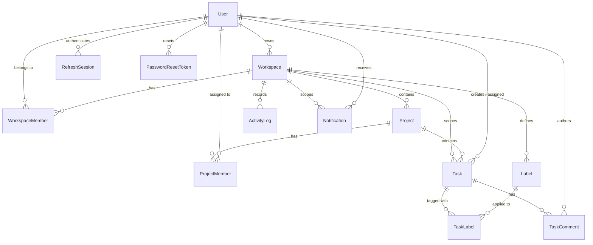

# FlowBoard — Database Schema

FlowBoard uses **PostgreSQL 16** managed via **Prisma ORM** (`apps/api/prisma/schema.prisma`) with versioned SQL migrations in `apps/api/prisma/migrations/`.

---

## Entity Relationship Diagram

---

## Relational Models (13 Models)

| Model | Purpose | Key Constraints & Indexes | Delete Policy |
| --- | --- | --- | --- |
| `User` | Core user profile & Argon2id password hash | Unique `email`, index on `email` | Restrict if owns workspace/project/tasks |
| `Workspace` | Multi-tenant isolation boundary | Unique `slug`, index on `ownerId`, `slug` | Cascades to members, projects, tasks, labels, activity, notifications |
| `WorkspaceMember` | User-to-workspace RBAC mapping (`OWNER`, `ADMIN`, `MEMBER`) | Unique `(workspaceId, userId)`, indexes on `userId` & `(workspaceId, role)` | Cascade on Workspace/User delete |
| `Project` | Project roadmap container with sequential `taskCounter` | Unique `(workspaceId, key)`, index on `(workspaceId, status)` | Cascade on Workspace delete |
| `ProjectMember` | Assigns workspace members to specific projects | Unique `(projectId, userId)` | Cascade on Project/User delete |
| `Task` | Core work item with floating-point `position` & optimistic `version` | Unique `(workspaceId, identifier)`, composite indexes on `(workspaceId, status, position)`, `(projectId, status, position)`, `(workspaceId, assigneeId)`, `(workspaceId, dueDate)` | Cascade on Project/Workspace; `SetNull` on Assignee delete |
| `Label` | Workspace-scoped colored tag | Unique `(workspaceId, name)` | Cascade on Workspace delete |
| `TaskLabel` | Many-to-many join between `Task` and `Label` | Composite PK `(taskId, labelId)` | Cascade on Task/Label delete |
| `TaskComment` | Threaded comments on tasks | Index on `(taskId, createdAt)` | Cascade on Task/User delete |
| `ActivityLog` | Workspace/project/task audit trail | Desc indexes on `(workspaceId, createdAt)`, `(projectId, createdAt)`, `(taskId, createdAt)` | Cascade on Workspace; `SetNull` on Project/Task delete |
| `Notification` | User inbox notifications | Index on `(userId, readAt, createdAt DESC)` | Cascade on Workspace/User delete |
| `RefreshSession` | Rotating hashed refresh tokens with revocation & metadata | Unique `tokenHash`, indexes on `(userId, revokedAt)`, `expiresAt` | Cascade on User delete |
| `PasswordResetToken` | One-time 30-minute hashed password reset tokens | Unique `tokenHash`, indexes on `userId`, `expiresAt` | Cascade on User delete |

---

## Kanban Ordering & Concurrency Strategy

- Each `Task` stores `position: Float` (IEEE 754 double precision) initialized in increments of `65536`.
- Moving a task between neighbors computes `(before + after) / 2` in `@flowboard/shared`.
- When a bisection gap falls below `0.001`, the API executes an atomic `prisma.$transaction` to rebalance the column back to clean `65536` steps.
- Every task mutation increments `version: Int`. Clients send `expectedVersion` on moves/updates so stale concurrent edits return `409 CONFLICT` rather than silently overwriting teammate changes.
