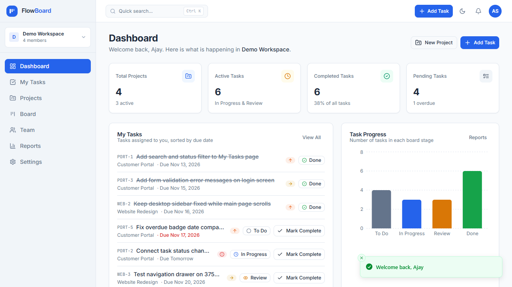
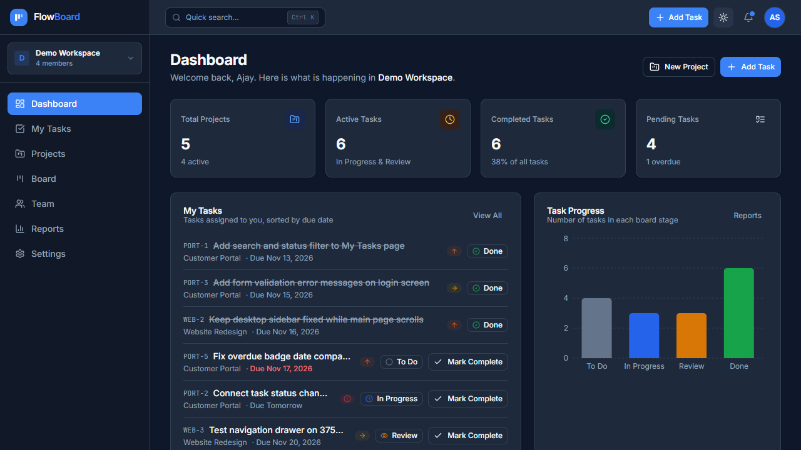
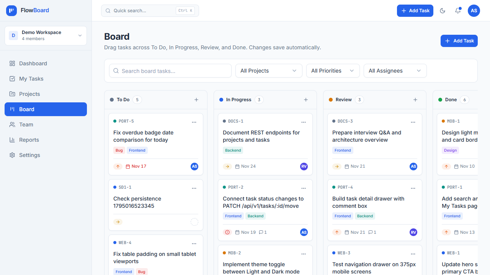
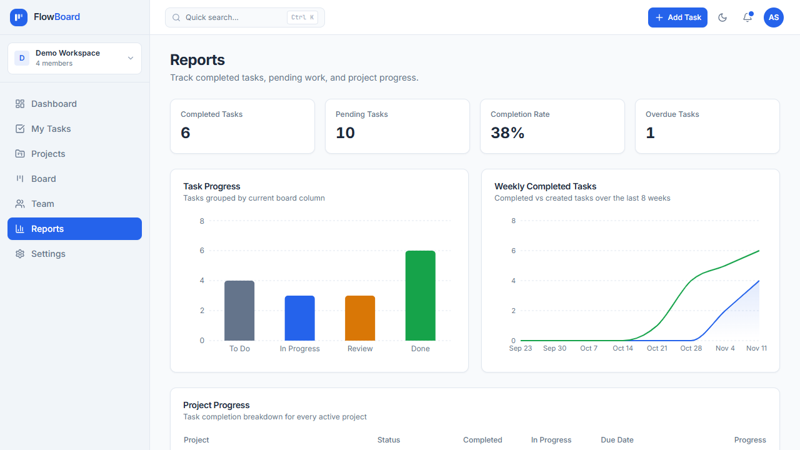
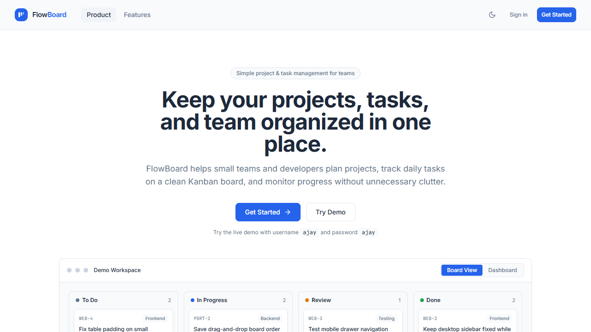

# FlowBoard — Project & Task Management App

FlowBoard is a clean, practical full-stack project and task management web application built with **React, TypeScript, Tailwind CSS, Recharts, `@dnd-kit`, Node.js, Express, Prisma, and PostgreSQL**.

Designed with a calm, light-first interface (`#F8FAFC` background, `#F1F5F9` fixed sidebar, white cards, `#2563EB` blue accents) and an understated dark mode toggle.

---

## Screenshots

Captured from the live running application (`docs/screenshots/`):

| Dashboard (Light — Default) | Dashboard (Dark) |
| :---: | :---: |
|  |  |

| 4-Column Task Board | Reports & Progress |
| :---: | :---: |
|  |  |

| Landing Page |
| :---: |
|  |

---

## Key Features

- **Clean Light-First UI + Simple Dark Mode**: Default light theme with soft borders, subtle blue accents, and a clean neutral dark mode toggle.
- **Fixed Desktop Sidebar & Mobile Drawer**: 240px full-height sidebar stays fixed while the main content scrolls independently; converts into a slide-over drawer on mobile (`375px`+).
- **Simple 7-Item Navigation**: Dashboard, My Tasks, Projects, Board, Team, Reports, and Settings (with Notifications neatly placed in the top header).
- **Focused Dashboard**: 4 statistic cards (Total Projects, Active Tasks, Completed Tasks, Pending Tasks), My Tasks with one-click Mark Complete, Recent Projects, Upcoming Deadlines, a Task Progress chart, and Recent Activity.
- **4-Column Kanban Board**: Drag-and-drop tasks across **To Do**, **In Progress**, **Review**, and **Done** with database persistence and quick-move menus.
- **Projects, Tasks, Team & Reports**: Full project & task CRUD, search and filtering, task detail drawer with comments, team member assignments, and live database-driven reports.
- **Safe Isolated Demo Login**: Try the pre-seeded demo workspace immediately with username `ajay` and password `ajay` (non-privileged demo account isolated from real user accounts).

---

## Tech Stack

- **Frontend (`apps/web`)**: React 18, TypeScript, Vite, Tailwind CSS, React Router, TanStack Query, React Hook Form + Zod, `@dnd-kit`, Recharts, Fetch API.
- **Backend (`apps/api`)**: Node.js, Express, TypeScript, Prisma ORM, PostgreSQL 16, Argon2 password hashing, HttpOnly JWT + rotating refresh cookies, CSRF protection, Socket.IO.
- **Shared (`packages/shared`)**: Shared TypeScript types and Zod schemas.
- **Testing**: Vitest, React Testing Library, Supertest, Playwright, `axe-core`.

---

## Local Setup & Quick Start

```bash
# 1. Install dependencies
npm install

# 2. Create local environment file
cp .env.example .env

# 3. Start PostgreSQL (Docker Compose or local PostgreSQL 16)
npm run db:up

# 4. Build shared types, generate Prisma client, run migrations & seed demo data
npm run build --workspace=@flowboard/shared
npm run db:generate
npm run db:migrate
npm run db:seed

# 5. Start API (http://localhost:8000) and Frontend (http://localhost:5173)
npm run dev
```

### Demo Credentials (Local Development)
- **Username**: `ajay`
- **Password**: `ajay`
- Or click **Try Demo** on `http://localhost:5173/login`.

*(Demo account uses a non-privileged `MEMBER` role inside an isolated `Demo Workspace`. Never use weak credentials for real or production admin accounts.)*

---

## Scripts & Testing

```bash
npm run typecheck   # TypeScript check across shared, api, web
npm run lint        # ESLint across api and web
npm run test        # Vitest backend (Supertest) + frontend (RTL + axe-core) suites
npm run test:e2e    # Playwright end-to-end tests + responsive checks (375px–1920px)
npm run build       # Production build for all workspaces
```

---

## Documentation

- [INTERVIEW_PREPARATION.md](./INTERVIEW_PREPARATION.md) — Plain-English project guide, 20 interview Q&As, 60s & 2-min pitches, and architecture diagram
- [ARCHITECTURE.md](./ARCHITECTURE.md) — Codebase layout, state architecture & security overview
- [API_DOCUMENTATION.md](./API_DOCUMENTATION.md) — Complete `/api/v1` REST API reference
- [DATABASE_SCHEMA.md](./DATABASE_SCHEMA.md) — PostgreSQL ERD and Prisma models
- [LOCAL_SETUP.md](./LOCAL_SETUP.md) — Detailed local setup guide
- [DEPLOYMENT_GUIDE.md](./DEPLOYMENT_GUIDE.md) — Vercel + Render + Managed PostgreSQL deployment steps
- [TESTING_GUIDE.md](./TESTING_GUIDE.md) — Automated test suites and commands
- [FEATURE_CHECKLIST.md](./FEATURE_CHECKLIST.md) — Implemented features and verified workflows
